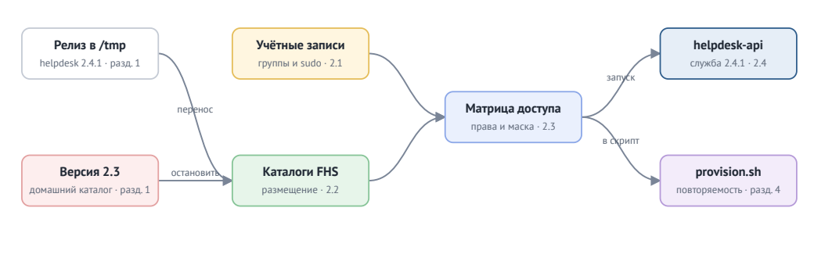

# Техническое задание № ТЗ-01/2026

## Ввод в эксплуатацию сервиса заявок helpdesk 2.4.1 на сервере helpdesk-01

Выкладка по стандарту FHS, служебная учётная запись, группы и правило sudo по ролям, права по матрице доступа, маска прав службы, скрипт повторяемой установки.

**ООО «Пятый склад»** — склады и курьерская доставка по Северо-Западу.

Общество с ограниченно                             й ответственностью «Пятый склад».

187 015, г. Северогорск, Складской проезд, д. 5.

ИНН 9905 405 512 · КПП 990501001 · ОГРН 1199900054410.

+7 (900) 505-55-05 · it@5sklad.example.

Исх. № ИТ-214 от 13.10.2026.

**УТВЕРЖДАЮ**

Директор по информационным технологиям ООО «Пятый склад» Е. С. Власова.

«13» октября 2026 г.

> Кейс ОП.05. Организация, реквизиты, печать и подписи вымышлены.

| Параметр | Значение |
| --- | --- |
| Заказчик | Общество с ограниченной ответственностью «Пятый склад», ИТ-отдел |
| Исполнители | пара практикантов группы эксплуатации<br>практикант 1: ____________________<br>практикант 2: ____________________<br>фамилия, имя, группа |
| Руководитель работ со стороны Заказчика | Тимлид разработки сервиса заявок helpdesk Ершов Павел Андреевич, ershov@5sklad.example, Telegram @ershov_helpdesk |
| Наставник | Орлова Анна Викторовна, orlova@5sklad.example, Telegram @orlova_ops |
| Сервер и вид работ | helpdesk-01, Ubuntu 24.04 · плановая выкладка новой версии |
| Основание | Практическая работа по дисциплине ОП.05 «Операционные системы и среды», работа в паре по темам 1–8 |
| Дата выдачи |  |
| Срок выполнения | 14 календарных дней с даты выдачи; этапы — в разделе 3.3 |
| Версия документа | 1.0 |

## Содержание

- Обращение Заказчика
- 1. Ситуация
- 2. Задача
- 3. Порядок работы
- 4. Сдача и проверка
- Приложение А. Пункты скрипта приёмки
- Приложение Б. Выдержки из регламентов
- Приложение В. Лист согласования
- Приложение Г. Акт сдачи-приёмки

## Обращение Заказчика

Практикантам группы эксплуатации, исполнителям технического задания № ТЗ-01/2026

### О задачах работы

Отдел поддержки «Пятого склада» — 38 специалистов — разбирает в сервисе заявок helpdesk около 1 900 обращений клиентов в день: потерянные посылки, перенос доставки, возвраты. Если helpdesk не работает, обращения копятся в почте, и клиенты ждут ответа часами.

Сейчас на сервере helpdesk-01 работает версия 2.3. Разработчики нашли в ней уязвимость: через вложение к обращению можно открыть чужие заявки с адресами и телефонами клиентов. Версия 2.4.1 эту уязвимость закрывает, сборочный конвейер уже выложил её на сервер.

Версию 2.3 предыдущий инженер запустил вручную из своего домашнего каталога от своей учётной записи. Настройки, пароль базы и токен почты лежат там же и открыты всем пользователям сервера. Служба информационной безопасности отметила это при последней проверке. Поэтому выкладку 2.4.1 нужно выполнить по стандарту компании СТ-01 и политике доступа ПД-02: файлы на своих местах, служба работает от своей учётной записи, каждая роль получает только нужные ей права.

Выкладка на рабочий сервер назначена на окно обслуживания в субботу с 06:00 до 08:00. Дежурный инженер выполнит её вашим скриптом provision.sh, поэтому скрипт должен быть проверен на копии сервера, развёрнутой заново. Вместе со скриптом жду матрицу доступа с фактическими правами и журнал работ.

Требования и порядок приёмки изложены ниже. По вопросам о сервисе обращайтесь к тимлиду разработки Павлу Ершову, по работе с сервером — к наставнику Анне Орловой.

- **1 900** обращений клиентов в день.
- **38** специалистов поддержки в helpdesk.
- **3** сотрудника получают доступ по ролям.
- **2 часа** — окно обслуживания в субботу.

Директор по информационным технологиям Е. С. Власова ООО «Пятый склад»

## 1. Ситуация

«Пятый склад» хранит товары интернет-магазинов и доставляет их покупателям: 14 складов в Северогорске и области, 600 курьеров, около 9 000 отправлений в день. Клиенты оформляют доставку на сайте и в приложении, оплату принимает собственный сервис billing, обращения клиентов разбирает отдел поддержки в сервисе helpdesk.

23 человека: разработка, группа эксплуатации (5 инженеров) и служба информационной безопасности. Внутренние сервисы работают на серверах Ubuntu 24.04 в собственной серверной. Группа эксплуатации устанавливает сервисы по стандарту, следит за их работой и закрывает доступ уволенным сотрудникам. С октября 2026 года в группе эксплуатации проходят производственную практику практиканты колледжа. Они работают парами, получают заявки из очереди группы и сдают работу наставнику. Изменения на рабочих серверах вносит дежурный инженер по отчёту и журналу работ пары.

Группа эксплуатации обслуживает три сервера: helpdesk-01 — сервис заявок отдела поддержки; billing-02 — приём платежей и ночная сверка с банком; ops-03 — сервер группы эксплуатации: скрипты выкладки магазина, общие папки, документы бухгалтерии. Это задание относится к серверу helpdesk-01. Работа ведётся по регламентам компании СТ-01 «Стандарт размещения сервисов», ПД-02 «Политика доступа», ПР-06 «Порядок работы группы эксплуатации»; выдержки из них — в Приложении Б.

### 1.1. Заявка

Работа начинается с заявки в очереди группы эксплуатации. Её текст приводится полностью.

CHG-2026-1047 Выкладка helpdesk 2.4.1 на helpdesk-01

Создана: 13.10.2026 09:12 Автор: Ершов Павел, тимлид helpdesk Приоритет: высокий

Сборка 2.4.1 лежит на сервере в /tmp/helpdesk-release-2.4.1. Состав и назначение файлов — в таблице ниже, программы — обычные скрипты bash.

Нашей команде нужно: Иванову и Петровой — запускать, останавливать и проверять службу и выкладывать файлы веб-интерфейса; Смирновой — читать журналы, чтобы разбирать жалобы клиентов. Паролей и базы нам видеть не нужно.

Версию 2.3 после запуска 2.4.1 не трогаем, откат не планируем.

### 1.2. Хронология и участники

События до выдачи задания и после него расположены по времени. Ниже — сотрудники, которых касается задание; их учётные записи используются в работе так, как они записаны в таблице.

| Когда | Что произошло |
| --- | --- |
| сентябрь 2026 | Служба информационной безопасности при проверке helpdesk-01 нашла открытый всем файл с паролями версии 2.3. |
| 10.10.2026 | Разработчики выпустили 2.4.1 с исправлением уязвимости во вложениях. |
| 13.10.2026, 09:00 | Сборочный конвейер выложил релиз в /tmp/helpdesk-release-2.4.1. Создана заявка CHG-2026-1047. |
| 13.10.2026 | Заявка передана паре практикантов. Учётных записей команды на сервере пока нет. |
| суббота, 06:00–08:00 | Окно обслуживания: дежурный инженер выполняет provision.sh на рабочем сервере. |

| Сотрудник | Должность | Учётная запись | Роль в задании |
| --- | --- | --- | --- |
| Власова Елена Сергеевна | директор по информационным технологиям | — | утверждает задания и отчёты группы эксплуатации |
| Орлова Анна Викторовна | инженер эксплуатации, наставник | orlova | принимает работу практикантов, отвечает в #ops |
| Ершов Павел Андреевич | тимлид разработки сервиса заявок helpdesk | — | автор заявки на выкладку 2.4.1 |
| Иванов Глеб Олегович | разработчик helpdesk | ivanov | управляет службой helpdesk, публикует веб-интерфейс |
| Петрова Дарья Ильинична | разработчик helpdesk | petrova | то же, что ivanov |
| Смирнова Ольга Павловна | старший специалист поддержки | smirnova | читает журналы helpdesk, разбирает жалобы клиентов |
| Мельников Сергей Юрьевич | руководитель отдела поддержки | — | 38 специалистов работают в helpdesk |

### 1.3. Состав релиза

На копии сервера, которую разворачивает стенд, находятся файлы и программы из таблицы. С них начинается осмотр сервера.

| Файл или каталог | Назначение |
| --- | --- |
| bin/helpdesk-api | служба: HTTP API, работает постоянно |
| bin/helpdesk-ctl | управление службой: start, stop, status |
| conf/helpdesk.conf | настройки, в том числе UMASK — маска прав для файлов службы |
| conf/secrets.env | пароль базы, токен почты, ключ подписи |
| data/tickets.db | база заявок |
| static/ | файлы веб-интерфейса |

Из заявки и обстановки на сервере следует задача пары. Она описана в части 2 как перечень требований: каждое требование проверяется при приёмке.

## 2. Задача

Результат работы описывается пятью целями:

1. Выложить helpdesk 2.4.1 по стандарту размещения СТ-01: программы, настройки, данные, веб-интерфейс, журналы и файл PID — каждый в своём каталоге.

2. Перевести службу с личной учётной записи на служебную учётную запись helpdesk без входа в систему.

3. Выдать доступ по ролям: разработчики, поддержка, служба. Права каждой роли совпадают с матрицей доступа, права шире матрицы отсутствуют.

4. Получить скрипт provision.sh, который выполняет всю выкладку на только что развёрнутом сервере.

5. Сдать матрицу доступа с фактическими правами и журнал работ, по которым дежурный инженер повторит выкладку на рабочем сервере.

Схема показывает части работы и порядок, в котором они связаны. Номер в блоке — раздел задания, где эта часть описана.



Требования ниже сгруппированы по тем же частям. Слова «должен» и «обязательно» обозначают требование, которое проверяется при приёмке. Номер требования записывается в журнал работ рядом с командами, которые его выполняют. Если требование и регламент расходятся, выполняется требование.

### 2.1. Учётные записи

**2.1.1** Служебная учётная запись helpdesk: системная (UID меньше 1000), без входа в систему, домашний каталог /var/lib/helpdesk.

**2.1.2** Разработчики ivanov и petrova — группа helpdesk-dev; поддержка smirnova — группа helpdesk-support. Каждому задан пароль.

**2.1.3** Никто из команды не состоит в группе sudo.

**2.1.4** Разработчики без пароля запускают от имени helpdesk только /usr/local/bin/helpdesk-ctl. Других команд через sudo им не разрешено. Правило — отдельный файл в /etc/sudoers.d, редактируется через visudo, права 440.

### 2.2. Размещение файлов

**2.2.1** Программы — /usr/local/bin; настройки и секреты — /etc/helpdesk; база — /var/lib/helpdesk; веб-интерфейс — /srv/helpdesk/static; журналы — /var/log/helpdesk; файл с PID службы — /run/helpdesk.

**2.2.2** После выкладки копия релиза из /tmp удалена.

### 2.3. Доступ

**2.3.1** Права выставлены по матрице доступа ниже. Права шире, чем в матрице, считаются ошибкой.

**2.3.2** Новые файлы, которые разработчики кладут в /srv/helpdesk/static, получают группу helpdesk-dev и доступны на изменение второму разработчику.

**2.3.3** Файлы, которые создаёт служба, недоступны группе на запись и закрыты для остальных: маска задаётся параметром UMASK в helpdesk.conf.

### 2.4. Служба

**2.4.1** Версия 2.3 остановлена.

**2.4.2** Версия 2.4.1 запущена командой helpdesk-ctl start от имени helpdesk. Если служба не стартует, helpdesk-ctl печатает причину — её нужно устранить, ослаблять права ради запуска нельзя.

### Матрица доступа

Матрица задаёт, что может каждая роль. Права шире, чем в матрице, считаются ошибкой.

| Ресурс | helpdesk | разработчики | поддержка | остальные |
| --- | --- | --- | --- | --- |
| helpdesk.conf | чтение | чтение | — | — |
| secrets.env | чтение | — | — | — |
| /var/lib/helpdesk | чтение и запись | — | — | — |
| журналы /var/log/helpdesk | запись | чтение | чтение | — |
| /srv/helpdesk/static | чтение | чтение и запись | — | — |

Запуск программ из /usr/local/bin разрешён всем. root в матрице не указан: для его процессов права не проверяются.

### 2.5. Задачи по выбору

Эти задачи выполняются после основных требований и дают дополнительные баллы. Файлы кладутся в папку optional/; при приёмке пара запускает скрипт на стенде или показывает документ.

| Файл | Что сделать | Баллы |
| --- | --- | --- |
| check-access.sh | Скрипт проверки матрицы доступа: для каждой клетки матрицы выполняет действие от имени роли через sudo -u и печатает строку «ресурс — роль — ожидается — получено — OK/FAIL». Ничего не изменяет. | +2 |
| rollback.md | План возврата к версии 2.3 на случай, если 2.4.1 не запустится в окне обслуживания: по шагам, с командами и проверкой каждого шага. Выполнять возврат не нужно. | +2 |

Требования выполняются на копии сервера, вдвоём, в течение 14 дней. Как устроены стенд, работа в паре и этапы, описано в части 3.

## 3. Порядок работы

### 3.1. Копия сервера

Изменения на рабочем сервере helpdesk-01 вносит дежурный инженер по отчёту пары. Пара работает на копии сервера: её разворачивает скрипт стенда в виртуальной машине с Ubuntu 24.04 из занятия 1. У каждого практиканта своя машина и свой стенд; нужно не меньше 2 ГБ свободного места и 2 ГБ памяти.

Перед первым запуском стенда в VirtualBox создаётся снимок состояния машины: к нему возвращаются, если машина перестала загружаться или потерян доступ к sudo. Стенд создаёт и удаляет учётные записи, правила sudo и каталоги служб, поэтому запускается только в виртуальной машине. Повторный запуск возвращает копию сервера в исходное состояние.

```bash
cd ~/Downloads
wget https://algorthimization-course-vvodnoe.vercel.app/op05-operacionnye-sistemy-i-sredy/proekty/ekspluataciya-servera/materials/helpdesk-stand.sh
wget https://algorthimization-course-vvodnoe.vercel.app/op05-operacionnye-sistemy-i-sredy/proekty/ekspluataciya-servera/materials/helpdesk-acceptance.sh
sudo bash helpdesk-stand.sh
```

Стенд создаёт каталог релиза в /tmp и запускает версию 2.3 из домашнего каталога вашей учётной записи. Учётные записи команды, каталоги службы и правила sudo стенд удаляет — их создаёте вы.

Скрипт приёмки ничего не изменяет: он проверяет копию сервера и печатает OK или FAIL по каждому из 25 пунктов. Пункт FAIL показывает, какое требование не выполнено; перевод пунктов — в Приложении А. Подгонять сервер под скрипт в обход требований запрещено.

```bash
sudo bash ~/Downloads/helpdesk-acceptance.sh | tee acceptance.txt
```

### 3.2. Работа в паре

Работа делится на две части, общую часть пара выполняет вместе. Кто из пары практикант 1 и кто практикант 2, записывается в README.md. При приёмке каждый отвечает и за свою часть, и за часть напарника.

| Кто | Что делает |
| --- | --- |
| Практикант 1 · учётные записи и sudo | служебная учётная запись, пользователи и группы, правило sudo, проверка правила от имени разработчика через sudo -u ivanov sudo -l. |
| Практикант 2 · размещение и права | каталоги по FHS, перенос файлов релиза, владельцы и права по матрице, общий каталог с setgid, маска службы. |
| Вместе | остановка версии 2.3, запуск 2.4.1, приёмка, общий скрипт provision.sh. |

У пары один репозиторий — tz-01-helpdesk: его создаёт практикант 1 и добавляет напарника в Settings → Collaborators. Каждый работает в своей ветке ( part-1, part-2 ) и открывает Pull Request в main. Напарник повторяет команды на своём стенде, оставляет замечания и одобряет слияние. Журнал работ runbook.md общий: время, кто из пары, команда, результат, номер требования; ошибки и откаты тоже записываются.

### 3.3. Этапы

День 0 — дата выдачи задания. К концу каждого этапа результат загружен в репозиторий, наставник может проверить его без предупреждения.

| Этап | Срок | Результат этапа |
| --- | --- | --- |
| 1. Подготовка | день 2 | Репозиторий, стенд у каждого, распределение частей, паспорт сервера server-passport.md |
| 2. Части практикантов | день 7 | Каждый выполнил свою часть требований и открыл Pull Request |
| 3. Ревью | день 9 | Напарник повторил часть на своём стенде, замечания исправлены, ветки слиты |
| 4. Сведение | день 12 | Общая часть, скрипт provision.sh, документ «матрица доступа», финальная приёмка на стенде заново |
| 5. Сдача | день 14 | Проверка по части 4 в присутствии обоих практикантов |

### 3.4. Материалы

Методичка, справочник команд, шаблоны документов и каркасы скриптов, раздел «Куда смотреть» по каждой задаче — на странице задания: https://algorthimization-course-vvodnoe.vercel.app/op05-operacionnye-sistemy-i-sredy/proekty/ekspluataciya-servera/tz-1-helpdesk.html. Лекции занятий 3–8 — на странице дисциплины ОП.05.

Работа заканчивается сдачей репозитория и проверкой в присутствии пары. Что сдаётся и как выставляются баллы, описано в части 4.

## 4. Сдача и проверка

### 4.1. Что сдаётся

Работа сдаётся одной ссылкой на репозиторий GitHub. README.md начинается с таблицы: практикант 1 и практикант 2, за что отвечает каждый, итог приёмки «N из 25»; ниже — команды стенда, решения и приёмки по порядку. В конце две строки: «Не получилось: ___» и «Нейросеть использовалась для: ___».

```text
tz-01-helpdesk/
├── README.md состав пары, кто за что отвечает, итог приёмки
├── server-passport.md паспорт сервера до изменений
├── runbook.md журнал работ
├── access-matrix.md матрица доступа
├── provision.sh скрипт повторяемости
├── acceptance.txt вывод приёмки после финального прогона
├── optional/ задачи по выбору
└── screenshots/ снимки из таблицы ниже
```

| Файл | Что в нём |
| --- | --- |
| server-passport.md | паспорт сервера до изменений: версия системы, учётные записи и группы из задания, процессы и их владельцы, заполнение разделов, каталоги из раздела 1.3. Для каждого сведения — команда, которой оно получено. |
| provision.sh | скрипт, который на только что развёрнутом стенде выполняет всю выкладку. Проверка повторяемости: стенд заново, sudo bash provision.sh, приёмка — все пункты OK. |
| access-matrix.md | матрица доступа с фактическими правами: для каждого ресурса строка ls -ld или stat и команда, которой проверен доступ каждой роли. |
| runbook.md | журнал работ: время, кто из пары, команда, результат. Ошибки и их исправление тоже записываются. |
| screenshots/ | отказ запуска службы и его причина; вывод приёмки со всеми OK. |

Шаблоны README.md, журнала работ, паспорта сервера и документа «матрица доступа», а также каркас скрипта provision.sh — в архиве шаблонов. Команды и их вывод в документах — только с вашей виртуальной машины.

### 4.2. Проверка

Проверка проходит в присутствии обоих практикантов и состоит из пяти испытаний. Пара заранее открывает виртуальную машину со снимком, репозиторий и журнал работ. Если испытание не пройдено, пара один раз устраняет замечания в течение 3 дней.

| № | Что проверяется | Действие Заказчика | Ожидаемый результат |
| --- | --- | --- | --- |
| И-01 | Решение и приёмка | Заказчик разворачивает стенд заново. Пара выполняет решение по журналу работ и своим скриптам, затем запускает скрипт приёмки | Не дольше 30 минут; все 25 пунктов OK, вывод совпадает с acceptance.txt |
| И-02 | Повторяемость | Стенд заново, затем sudo bash provision.sh и скрипт приёмки | Все 25 пунктов приёмки OK |
| И-03 | Доступ по матрице | Заказчик называет клетку матрицы доступа, например «поддержка — secrets.env» | Исполнитель проверяет её командой от имени роли; результат совпадает с матрицей |
| И-04 | Отказ запуска | Заказчик просит показать в журнале работ первый отказ запуска службы | Исполнитель называет причину по сообщению helpdesk-ctl и объясняет, как её устранил, не ослабив права |
| И-05 | Журнал и часть напарника | Заказчик выбирает строку runbook.md из части напарника | Практикант объясняет команду, её ключи и вывод, называет номер требования |

### 4.3. Оценка

Работа оценивается в 30 баллов. Оценку получает пара, вклад каждого виден по коммитам, Pull Request и журналу работ.

| Что оценивается | Баллы |
| --- | --- |
| Приёмка на стенде, развёрнутом заново (И-01): баллы пропорциональны числу пунктов OK из 25 | 10 |
| Скрипт provision.sh выполняет свою задачу на чистом стенде (И-02) | 5 |
| Документ «матрица доступа»: по фактам, с командами и выводом | 5 |
| Паспорт сервера и журнал работ | 4 |
| Работа в паре: свои ветки, Pull Request, ревью с замечаниями | 3 |
| Ответы на испытаниях И-03 — И-05 | 3 |
| Итого | 30 |
| Дополнительно: задачи по выбору | +4 |

| Баллы | 27–30 | 23–26 | 18–22 | меньше 18 |
| --- | --- | --- | --- | --- |
| Оценка | 5 | 4 | 3 | работа возвращается на доработку |

Работа не принимается, если решение не воспроизводится на стенде, развёрнутом заново, нет журнала работ или права ослаблены ради запуска службы или пункта приёмки.

## Приложение А. Пункты скрипта приёмки

Скрипт helpdesk-acceptance.sh печатает пункты на английском языке, сгруппированные по частям. В таблице — что означает каждый пункт и какое требование части 2 он проверяет. Требования, которые скрипт проверить не может, проверяются по документам и на испытаниях части 4.

| № | Строка в выводе | Что проверяется | Требование |
| --- | --- | --- | --- |
| Accounts |  |  |  |
| 1 | helpdesk: system account without login shell | служебная учётная запись системная и без входа в систему | 2.1.1 |
| 2 | ivanov and petrova are in helpdesk-dev | разработчики в группе helpdesk-dev | 2.1.2 |
| 3 | smirnova is in helpdesk-support, not in helpdesk-dev | поддержка в своей группе и не в группе разработчиков | 2.1.2 |
| 4 | nobody of the team has sudo group | никто из команды не в группе sudo | 2.1.3 |
| Layout |  |  |  |
| 5 | programs in /usr/local/bin | программы на месте | 2.2.1 |
| 6 | configuration in /etc/helpdesk | настройки и секреты на месте | 2.2.1 |
| 7 | database in /var/lib/helpdesk | база на месте | 2.2.1 |
| 8 | static files in /srv/helpdesk/static | веб-интерфейс на месте | 2.2.1 |
| 9 | release copy removed from /tmp | копия релиза удалена | 2.2.2 |
| Access |  |  |  |
| 10 | developers read helpdesk.conf | разработчики читают настройки | 2.3.1 |
| 11 | developers cannot read secrets.env | разработчикам секреты закрыты | 2.3.1 |
| 12 | support cannot read secrets.env | поддержке секреты закрыты | 2.3.1 |
| 13 | support reads api.log | поддержка читает журнал | 2.3.1 |
| 14 | developers read api.log | разработчики читают журнал | 2.3.1 |
| 15 | support cannot change api.log | поддержка не изменяет журнал | 2.3.1 |
| 16 | other users cannot read logs and configuration | остальным журналы и настройки закрыты | 2.3.1 |
| 17 | only helpdesk enters /var/lib/helpdesk | в каталог данных входит только служба | 2.3.1 |
| 18 | developers publish static files, group is kept | файл одного разработчика изменяет второй | 2.3.2 |
| 19 | helpdesk reads static files | служба читает веб-интерфейс | 2.3.1 |
| Service |  |  |  |
| 20 | version 2.3 is stopped | версия 2.3 остановлена | 2.4.1 |
| 21 | helpdesk-api 2.4.1 runs as helpdesk | служба 2.4.1 работает от helpdesk | 2.4.2 |
| 22 | service umask closes group write and other users | маска службы соответствует требованию | 2.3.3 |
| 23 | developers run helpdesk-ctl as helpdesk without password | разработчики управляют службой через sudo | 2.1.4 |
| 24 | developers cannot run other commands as helpdesk or root | другие команды через sudo запрещены | 2.1.4 |
| 25 | sudoers rules for helpdesk are valid, mode 440 | файл правила корректен, права 440 | 2.1.4 |

## Приложение Б. Выдержки из регламентов

Регламенты ИТ-отдела ООО «Пятый склад», которые относятся к этому заданию. Полные тексты хранятся во внутренней базе знаний группы эксплуатации.

### СТ-01 «Стандарт размещения сервисов»

Как устанавливается любой внутренний сервис компании. Отступления согласуются с руководителем группы эксплуатации письменно.

#### 1. Каталоги

Исполняемые файлы сервиса — /usr/local/bin.

Настройки — `/etc/<сервис>/`. Секреты — отдельным файлом в том же каталоге.

Постоянные данные — `/var/lib/<сервис>/`. Файлы, которые отдаются клиентам как есть (веб-интерфейс), — `/srv/<сервис>/`.

Журналы — `/var/log/<сервис>/`. Файлы с номером процесса — `/run/<сервис>/`.

Временные копии релизов после установки удаляются.

#### 2. Учётные записи сервисов

Каждый сервис работает от собственной системной учётной записи (UID меньше 1000) без возможности входа в систему.

Запуск сервиса от root, от личной учётной записи сотрудника или из домашнего каталога запрещён.

#### 3. Повторяемость

Установка сервиса оформляется скриптом, который выполняет её на чистом сервере. Скрипт хранится в репозитории группы эксплуатации.

### ПД-02 «Политика доступа»

Кто и как получает доступ к серверам, данным и правам администратора.

#### 1. Принцип

Каждый сотрудник и каждый сервис получает только те права, которые нужны для его работы. Доступ «на всякий случай» не выдаётся.

Права выдаются группам: роль — группа, сотрудник входит в группу своей роли.

#### 2. Права администратора

Группа sudo — только у сотрудников группы эксплуатации.

Остальным сотрудникам sudo разрешает конкретные команды по их роли. Правило — отдельный файл `/etc/sudoers.d/<сервис>`, права 440, правка только через visudo.

Правила вида ALL=(ALL) NOPASSWD: ALL для отдельных сотрудников запрещены.

#### 3. Секреты

Пароли, токены и ключи хранятся в файлах, доступных только root или учётной записи сервиса.

Секреты не хранятся в домашних каталогах, общих папках и заметках.

#### 4. Проверка

Доступ проверяется от имени каждой роли: что роли нужно — работает, что не нужно — запрещено. Результат проверки прикладывается к отчёту.

### ПР-06 «Порядок работы группы эксплуатации»

Как оформляется любая работа по заявке.

#### 1. Журнал работ

Каждая команда, изменяющая сервер, записывается: время, кто, команда, результат. Ошибки и откаты тоже.

#### 2. Работа в паре

Заявку выполняет пара. Работа делится на части, каждая часть проходит ревью напарника: он повторяет её на своей копии сервера.

Изменения хранятся в репозитории пары: ветка на каждого, Pull Request, ревью, слияние.

#### 3. Сдача

Работа сдаётся отчётом по форме заявки и выводом скрипта приёмки, полученным на копии сервера, развёрнутой заново.

Ослаблять права, чтобы сервис запустился, запрещено. Причину отказа ищут в сообщении сервиса и его журнале.

## Приложение В. Лист согласования

| Должность | ФИО | Подпись | Дата |
| --- | --- | --- | --- |
| Директор по информационным технологиям | Власова Елена Сергеевна |  | 13.10.2026 |
| Тимлид разработки сервиса заявок helpdesk | Ершов Павел Андреевич |  | 13.10.2026 |
| Инженер группы эксплуатации, наставник практикантов | Орлова Анна Викторовна |  | 13.10.2026 |
| Практикант 1: с заданием ознакомлен |  |  |  |
| Практикант 2: с заданием ознакомлен |  |  |  |

## Приложение Г. Акт сдачи-приёмки

к техническому заданию № ТЗ-01/2026. Заполняется Заказчиком при приёмке.

| № | Испытание | Пройдено | Замечание |
| --- | --- | --- | --- |
| И-01 | Решение и приёмка | ☐ да ☐ нет |  |
| И-02 | Повторяемость | ☐ да ☐ нет |  |
| И-03 | Доступ по матрице | ☐ да ☐ нет |  |
| И-04 | Отказ запуска | ☐ да ☐ нет |  |
| И-05 | Журнал и часть напарника | ☐ да ☐ нет |  |

Итог приёмки: ____________________

Баллы: ____________________

Оценка: ____________________

Заказчик: ____________________ (подпись, расшифровка)

Место для штампа «Работа принята».
